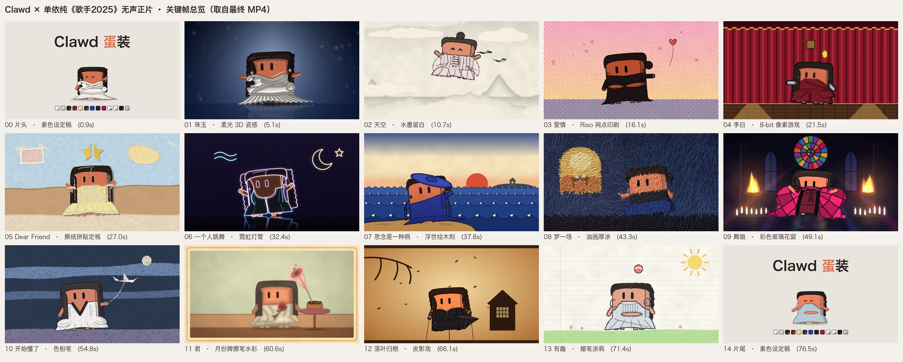

# Clawd 蛋装

Clawd 依次换上单依纯《歌手2025》13 首竞演曲目的舞台造型，每首歌用一种画风，做成一支 76.8 秒的动画短片。

整个项目由 **Claude Code + Opus 5.5** 完成，包括角色造型设计、动画、转场、渲染和验收，中间经过多轮人工审核修改。画面全部用 Python 程序绘制（矢量 SVG 加逐帧重绘），没有使用 AI 图像生成，也没有把照片贴到角色身上。



## 成片

[`最终版.mp4`](最终版.mp4)：1920×1080，30 fps，76.8 秒。视频编码为 HEVC（H.265），音频为 AAC。部分 Windows 设备需要安装 HEVC 扩展才能播放。

## 13 套造型与画风

| # | 歌曲 | 画风 |
|---|---|---|
| 01 | 珠玉 | 柔光 3D 瓷感 |
| 02 | 天空 | 水墨留白 · 云上飞行 |
| 03 | 爱情 | Riso 网点印刷 |
| 04 | 李白 | 8-bit 像素游戏 |
| 05 | Dear Friend | 撕纸拼贴定格 |
| 06 | 一个人跳舞 | 霓虹灯管 |
| 07 | 思念是一种病 | 浮世绘木刻 |
| 08 | 梦一场 | 油画厚涂 |
| 09 | 舞娘 | 彩色玻璃花窗 |
| 10 | 开始懂了 | 色粉笔 |
| 11 | 君 | 月份牌擦笔水彩 |
| 12 | 落叶归根 | 皮影戏 |
| 13 | 有趣 | 蜡笔涂鸦 |

每首歌之间有一个转场"小事件"，一共 14 个，例如钻水管、拉灯关灯、推开大殿的门、揉纸团踢飞。每个画风的选择理由和转场设计，详见 [`视频正片/说明.md`](视频正片/说明.md)。

## 目录

```
最终版.mp4                 成片
角色造型_第一轮审核/        13 套造型的静态审核图（PNG）
  源文件/                  造型源码（clawd.py、looks.py）、可编辑 SVG、生成记录
视频正片/
  说明.md                  画风、转场、渲染命令、各轮修改记录、已知限制
  关键帧总览.png           片头、13 段、片尾的关键帧
  画风检查_13格无标签.png  每段一帧，不带歌名，用于对比画风
  源文件/                  动画源码：引擎、重绘器、13 个场景、转场、拼接、验收
    检查/                  验收报告与检查拼图
```

## 运行环境与重新渲染

**只能在 macOS 上运行。** 代码直接引用了系统字体（冬青黑体、宋体，见 `视频正片/源文件/engine.py`）；静态造型图用本机 Chrome 无头模式渲染（路径见 `角色造型_第一轮审核/源文件/render.py`）。

```bash
pip install -r requirements.txt
```

重新生成静态造型审核图：

```bash
cd 角色造型_第一轮审核/源文件
python3 render.py ..         # 生成全部 SVG 和 PNG，也可以只写编号，例如 python3 render.py .. 7 9
python3 overview.py ..       # 重新排版总览图
```

重新渲染动画（在 `视频正片/源文件/` 下运行）：

```bash
python3 render.py clip all   # 13 段 + 片头片尾
python3 render.py work 00,14 # 片头片尾工作版（转场需要）
python3 render.py trans all  # 14 个转场
python3 film.py              # 拼接完整无声正片
python3 verify.py            # 验收报告与检查图
```

渲染出的 mp4 写在 `视频正片/` 下，已被 `.gitignore` 排除，不会提交进仓库。程序输出的是无声正片；`最终版.mp4` 的音轨是后期另外加入的。完整命令见 [`视频正片/说明.md`](视频正片/说明.md)。

## 参考与致谢

- [Claude-Mascot-Style-Gallery](https://github.com/henrik-thevibe/Claude-Mascot-Style-Gallery)（MIT）：参考了"同一个 Clawd 几何经不同重绘器处理成不同画风"的方法。本项目代码是独立实现的，为了署名保留了它的许可全文：[`视频正片/源文件/LICENSE_Claude-Mascot-Style-Gallery_MIT.txt`](视频正片/源文件/LICENSE_Claude-Mascot-Style-Gallery_MIT.txt)。
- [opus-5.5-musical-cartoon](https://github.com/az9713/opus-5.5-musical-cartoon)：只参考了制作方法（画面写成时间的纯函数、固定随机种子、检查拼图等），没有使用其代码或素材。

## 声明

- 这是非官方的同人和技术演示项目，与 Anthropic、单依纯本人及《歌手2025》节目方均无关联。
- Clawd 角色与 Claude 名称归 Anthropic 所有。
- 造型设计参考了单依纯在《歌手2025》的舞台服装。参考照片的版权归原摄影师及节目方所有，不包含在本仓库中。
